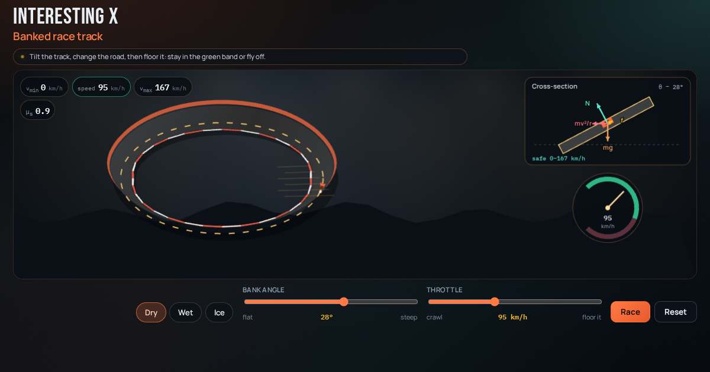

# Banked race track

Tilt the bank, pick Dry / Wet / Ice, then floor it — stay in the green speed band or fly off the curve.



**Live demo:** https://interesting-x.scorpion-labs.com/banked-curve/

Inspired by a bookmark from [@matheorems](https://x.com/matheorems/status/2106670916448956516).

Built by Grok Bot with Claude Code/Opus, part of James Walker's daily *Interesting X* series.

## Run locally

```bash
npm install
npm run dev      # then open the printed URL (served under /banked-curve/)
npm run build    # static output in dist/
```

## Notes


Playful canvas playground for why highway ramps and race tracks are tilted: stay inside the green `[v_min, v_max]` band or skid off.

Inspired by [@matheorems](https://x.com/matheorems/status/2106670916448956516).

## Run locally

```bash
npm install
npm run dev -w @tech-demos/banked-curve
```

## Physics

With bank angle `θ`, static friction `μ_s`, radius `r = 80 m`, and `g = 9.81`:

- `v_max = √( r g (sin θ + μ_s cos θ) / (cos θ − μ_s sin θ) )`
- `v_min = √( r g (sin θ − μ_s cos θ) / (cos θ + μ_s sin θ) )` (clamped to 0)
- Ideal (μ_s = 0): `v = √( r g tan θ )`

Surfaces: Dry ≈ 0.9, Wet ≈ 0.5, Ice ≈ 0.1.

## Record

```bash
npm run record -- banked-curve
```

## License

MIT © 2026 James Walker
